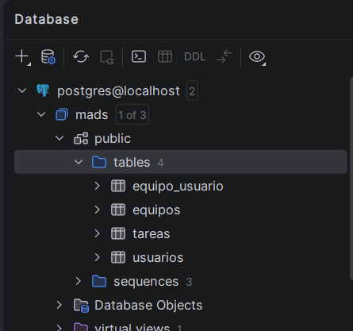

# Práctica 3 – Documentación técnica

Resumen de lo hecho en las funcionalidades 009 (pertenencia a equipos) y 010 (gestión de equipos).

## Base de datos

Tablas de la base de datos PostgreSQL vistas desde el panel Database de IntelliJ: `equipos`, `equipo_usuario`, `usuarios` y `tareas`. La relación entre equipos y usuarios se guarda en `equipo_usuario`.



## Endpoints

| Ruta | Quién | Qué hace |
|---|---|---|
| `GET /equipos/nuevo` | logeado | Formulario para crear equipo |
| `POST /equipos/nuevo` | logeado | Crea el equipo |
| `POST /equipos/{id}/unirme` | logeado | El usuario se une al equipo |
| `POST /equipos/{id}/salir` | logeado | El usuario sale del equipo |
| `GET /equipos/{id}/editar` | admin | Formulario para cambiar el nombre |
| `POST /equipos/{id}/editar` | admin | Guarda el nuevo nombre |
| `DELETE /equipos/{id}` | admin | Borra el equipo |

Si el equipo no existe se devuelve 404. Sin login, o si el usuario no es admin en los endpoints de gestión, se devuelve 401. Los errores de validación (nombre vacío, ya ser miembro, etc.) se muestran en la vista con un atributo flash `error`.

## Cambios en el código

- `Equipo`: se añaden `setNombre()` y `removeUsuario()`.
- `EquipoService`: nuevos métodos `eliminarUsuarioDeEquipo()`, `modificarNombreEquipo()` y `borrarEquipo()`. Ahora `crearEquipo()` no deja crear equipos con nombre vacío y `añadirUsuarioAEquipo()` falla si el usuario ya está en el equipo. Para no repetir código he sacado `getEquipoOrThrow()`, `getUsuarioOrThrow()` y `comprobarNombreValido()`.
- `EquipoController`: los endpoints de la tabla, más `comprobarEquipoExiste()` y `comprobarUsuarioAdministrador()`. El listado pasa a la vista los equipos del usuario (`equiposUsuario`) y si es admin (`esAdmin`).

## Plantillas

- `formNuevoEquipo.html` y `formEditarEquipo.html`: formularios con el nombre del equipo.
- `listaEquipos.html`: en cada fila sale el botón Unirme o Salir según si el usuario pertenece al equipo. Si es admin aparecen también Editar y Borrar. El borrado se hace con un `fetch` DELETE con confirmación, igual que en las tareas.

## Algunos detalles

Al quitar un usuario de un equipo hay que actualizar los dos lados de la relación muchos-a-muchos. Si no, el `Usuario` en memoria sigue teniendo el equipo en su lista:

```java
public void removeUsuario(Usuario usuario) {
    this.getUsuarios().remove(usuario);
    usuario.getEquipos().remove(this);
}
```

Para borrar un equipo primero se quitan todos sus usuarios. Se recorre una copia del conjunto porque `removeUsuario()` lo modifica, y si no daría `ConcurrentModificationException`:

```java
for (Usuario usuario : new ArrayList<>(equipo.getUsuarios())) {
    equipo.removeUsuario(usuario);
}
equipoRepository.delete(equipo);
```

Ocultar los botones de editar y borrar con `th:if="${esAdmin}"` no es suficiente, porque cualquiera podría lanzar la petición a mano. Por eso el controlador también lo comprueba con `comprobarUsuarioAdministrador()`.

## Tests

En `EquipoServiceTest` hay tests para crear con nombre vacío, añadir un usuario que ya es miembro, eliminar un usuario de un equipo, modificar el nombre y borrar el equipo, cada uno con sus casos de excepción.

En `GestionEquiposWebTest` se prueban los endpoints con `MockMvc`, simulando la sesión con `@MockBean`. Para la 009 se prueba crear equipo, unirse y salir (y sus errores), que el listado muestre el botón correcto y que sin login no se pueda acceder. Para la 010 se prueban tres casos: el admin puede editar y borrar y ve los botones, un usuario normal no ve los botones y recibe 401, y sin login también da 401.
